# How You Prove is How You Code

A Practical Introduction to Thinking in Mathematical Induction for Software Engineers

## Preface

You might have heard this during college days: "Proof by induction".

I did during my first year in discrete math class. Those were the days when we were given a paper, a claim, and a command: "Prove the claim using induction."

Just like a youngling I was, I did what many might also do. Try do well in class, get the assignment done, get my GPA, and move on to next year, never looking back.

But there's something about proof by induction that repeatedly nagged into my mind over the year.

> "How?"
>
> "How come we prove the induction step, then prove the base case, then suddenly everything is solved?"

Years passed and the question remain unanswered.

Until recent years. I think it's somewhere just before covid days.

That was the time it _clicked_ to me, how _beautifully, elegantly, cleverly_ done a proof by induction is. A difficult problem can be untangled just in two claims, then prove them two, and you can get a nice working solution.

That, among other nice surprises, that really benefit my career years in software engineering.

So I want to share this journey with you in hope I can pique your interest and make you pick up proof by induction. Who knows, maybe you also will take up this long journey as well. Then, hopefully,

you can become a better software engineer by abusing thinking in mathematical induction.

Because dear God, the moment it _clicked_ to me is like I'm being given a cheat code that unlock many previously hard problems as a software engineer.

### What you should expect and need in this article

This article has **lots** of reading and hand-holding. Rather than handing you the answer upfront, I will be leading you to the steps into that discovery, including the wrong turn I take.

Because maybe the real learning is the mistakes we made along the way.

Also it's a good idea to split the reading into multiple session:

- Session 1: From "Preface" up to "OK Boring. Lets jump to the problem"
- Session 2: From "Wake up Honey! It's time to make our dream into reality!" up to "The square puzzle"
- Session 3: Whole "Distributed system" section
- Session 4: From "How to practice" to "That's a wrap!"

Distributed system section also assumes slight familiarity with...well, distributed system. You don't need to master microservice, just knowing how an application can interact with other application is enough.

## Why Bother?

Yes, let's address the elephant in the room first.

The days when we learn our way into software engineering is full with technical, _down-to-earth_, _hands-on_ knowledge. You name it: how to make SQL query, how to make index, how to build CRUD web application, how to center a `div`, and all of the thingamajigs.

Some of us maybe have no exposure to more "math-y" areas, including proof by induction technique. Even so, they can be a great engineer. Very capable engineer, even. So the skepticism is valid:

> "Why do I need to care about proof by induction, or thinking in mathematical induction as your title suggest, if people can work just fine?"

What if I tell you this:

> 50% of engineering problem can be approached using proof by induction

I made up that statistics. The number is purely anecdotal based on personal experience. But the point still stands: so many engineering problem can be _unlocked_ by proof by induction, maybe even ones that we never thought possible.

Therefore, if we can do proof by induction, or at least to think using mathematical induction, those "50%" could be at our hands. The application is **vast**.
1. Programming problem (yuck)
2. Answering system design interview
3. Actually designing system for production use with real user and real money

And do you know the best part?

Proof by induction can be a constructive proof. Meaning the same way we prove it is the way we can build it. Often how you prove is how you code. HYPIHYC. Focusing in proving a problem could (_could_, not _will_) automatically reveal how to implement it.

One other benefit on adopting mathematical induction mental model is that you _could_ be more resilient with unknown problems. You don't need to be very knowledgeable on existing solutions in the world. You _could_ make your own solution, building from more basic understanding. And in the realm where we are constantly faced with new problems, this matters big time.

Imagine that you somehow realize that your work is solvable by some specific approach, because you noticed what is the actual problem with the work, only to someone to say, "Oh, you used [INSERT FAMOUS PATTERN HERE]! That's cool." Then you go, "Huh? What's that?"

I can personally attest this by experience, figured out my implementation is literally Kadane algorithm.

Now I don't want to be an evangelist. Proof by induction is not without a flaw: it cannot solve every kind of problem. Even if a problem can be solved using proof by induction, it could be **very** difficult.

But that's why software engineer exist. That's where we come in. We solve this hard part.

_...Supposedly._

All in all, thinking in mathematical induction is one of the medium for me to become a better engineer. Alhamdulillah.

Interested yet? Let's discuss the core of the topic next.

## The Formal Definition

Textbook definition of proof by induction is something along this line.

Given a proposition $ P $, if we can prove true for both of the following,
1. $ P(n_0) $ for some $ n_0 $
2. $ P(x) \rightarrow P(x + 1) $

then $ P $ is true for all $ x \geq n_0 $.

Bullet number 1 is called the _base case._

Bullet number 2 is called the _inductive step._

I think. Maybe. It has been a long time since my class. I'm old.

## OK Boring. Let's jump to the problem

Let's do a puzzle. The question is simple:

> Can we build a square using exactly $ n $ squares?

Note that the $ n $ squares can be in various sizes. Also of course there must be no gap in the resulting square. So having hole does not count.

In programming problem style:

```ts
// Of course n is positive integer. 0 does not count
function isSquarable(n: number) : boolean {
    // ...
}
```

I promise insya Allah that this is relevant to the discussion, so bear with me.

This is the good time to stop and try it for yourself, if you would like. If you're done, read on.

### Help what am I supposed to do?

The problem ask if we can build square using some other amount of squares.

The most trivial solution is of course square numbers.

$$
1, 4, 9, 16, 25, 36, 49, ...
$$

Now the million dollar question: can we even build a square using non-square number amount of squares?

As it turned out, yes. Here's an example.

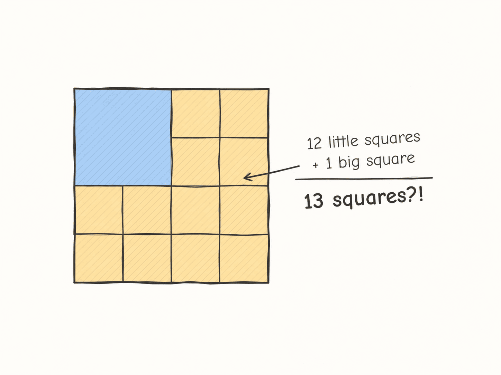

Right, this example shows that it's possible. Now the next question, how can we arrange non-similar-sized squares to make a bigger square?

Again, this is the good time to stop and try it for yourself. The next part will be where I show my reasoning to answer the puzzle. Your approach could be different. Here be dragons.

### Let's go

So I ruminated around the square numbers.

$$
1, 4, 9, 16, 25, 36, 49, ...
$$

And I recounted a nice way to calculate square number without multiplication:

$$
n^2 = \sum_{i = 0}^{n-1} 2i + 1
$$

Then I figured something:

$$
1\underbrace{}_{+3}4\underbrace{}_{+5}9\underbrace{}_{+7}16\underbrace{}_{+9}25\underbrace{}_{+11}36\underbrace{}_{+13}49 ...
$$

There's a pattern between two adjacent square numbers. Primarily in the difference between the numbers. So I went back to the sum formula: what if I can capitalize this form?

To reach $ 36 $ from $ 25 $, I need to add $ 11 $. Now $ 25 = 5^2 $, and $ 36 = 6^2 $. What to do with this?

What if I write everything with $ 5 $ as the term?

$$
\begin{aligned}
    36 &= 25 + 11 \\
    6^2 &= 5^2 + 11 \\
    (5 + 1)^2 &= 5^2 + (5 * 2 + 1) \\
    (n + 1)^2 &= n^2 + 2n + 1
\end{aligned}
$$

Oh. This is just algebra. I just transformed a solution back into algebraic form. That's not useful.

Wait.

Back up.

$$
\begin{aligned}
    n^2 &= \sum_{i = 0}^{n-1} 2i + 1
\end{aligned}
$$

What if I do this plug $ n = k + 1 $.

$$
\begin{aligned}
    (k + 1)^2 &= \sum_{i = 0}^{(k + 1) - 1} 2i + 1 \\
    (k + 1)^2 &= \sum_{i = 0}^{k} 2i + 1
\end{aligned}
$$

Now what happen if I turn the summation back to only $ k - 1 $.

$$
\begin{aligned}
    (k + 1)^2 &= \sum_{i = 0}^{k} 2i + 1 \\
    (k + 1)^2 &= (\sum_{i = 0}^{k - 1} 2i + 1) + (2k + 1) \\
    (k + 1)^2 &= (k^2) + (2k + 1)
\end{aligned}
$$

Aw. I keep repeating myself. This is just algebra acrobatics. I can build a square number based on smaller square number if I add a correct number.

Huh?

?????

_I can build a square number based on smaller square number?_

Wait let me

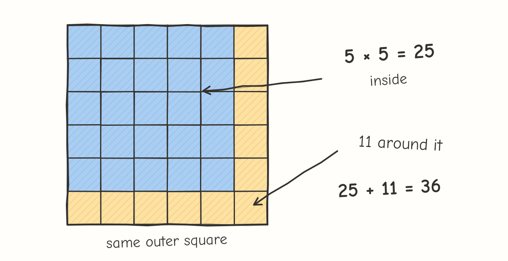

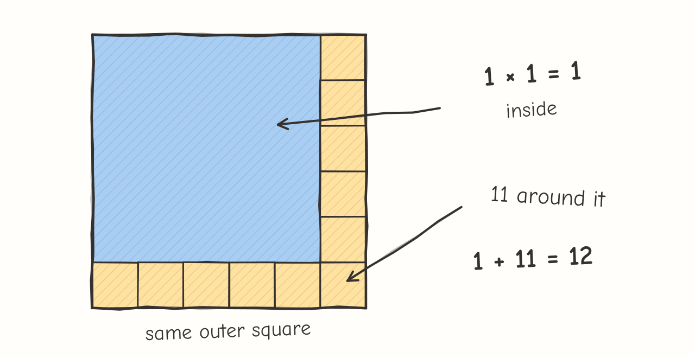

Wait.

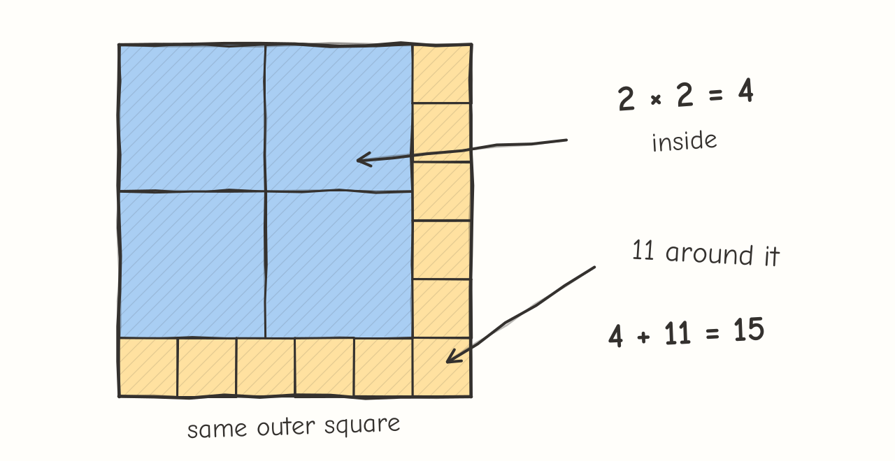

WAIT.

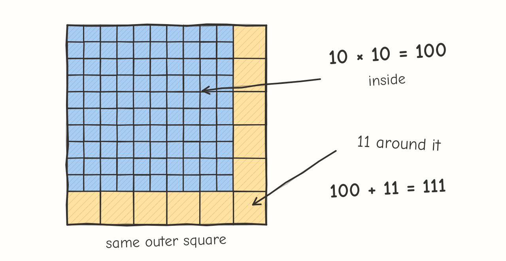

OH MY GOD.

<br/>
<br/>
<br/>
<br/>
<br/>
<br/>
<br/>
<br/>
<br/>

Sorry I need to calm down.

Ok so as it turned out, I can get creative with this equation:

$$
(n + 1)^2 = n^2 + 2n + 1
$$

Notice the following.

$$
\underbrace{(n + 1)^2}_{\text{square number}} = \underbrace{n^2}_{\text{square number}} + 2n + 1
$$

The equation states how to make bigger square using square of same size. So why don't I relax the definition:

$$
\text{squarable}_A = \text{squarable}_B + 2n + 1
$$

where $ \text{squarable} $ is a number where we can construct into a square. This is ok because the puzzle don't need us to use same sized square.

So this means I can use any $ \text{squarable} $ number to make a bigger squarreee....?

Wait so that means

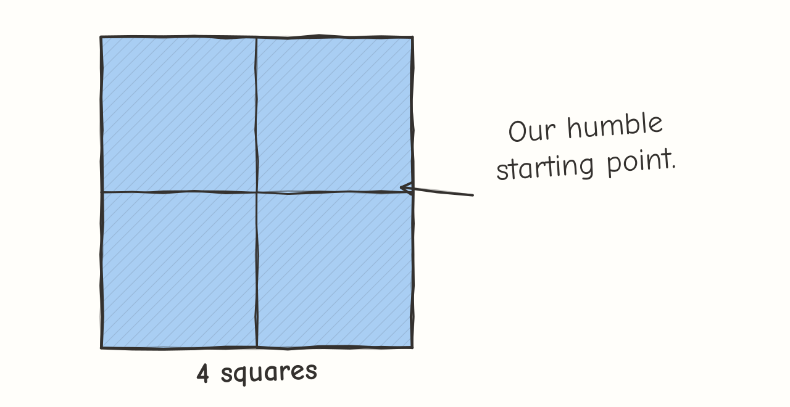

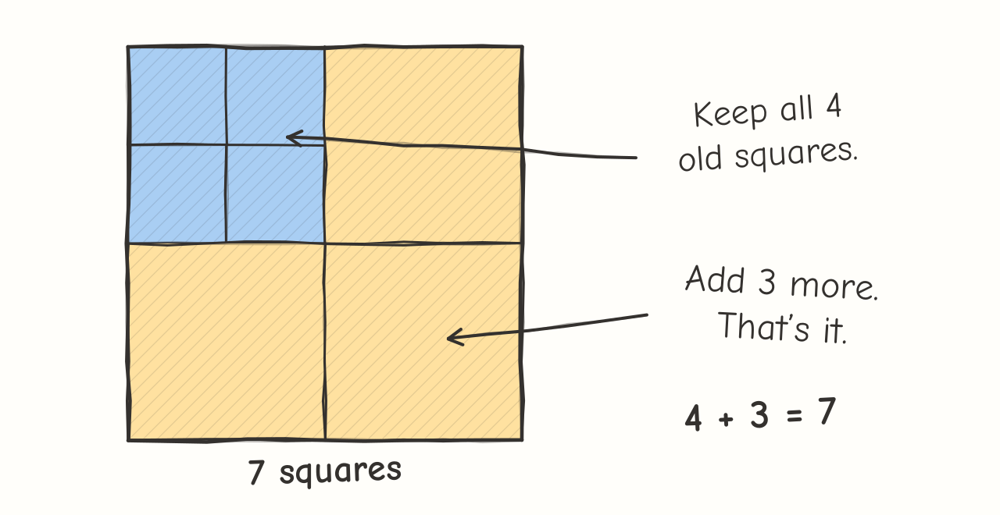

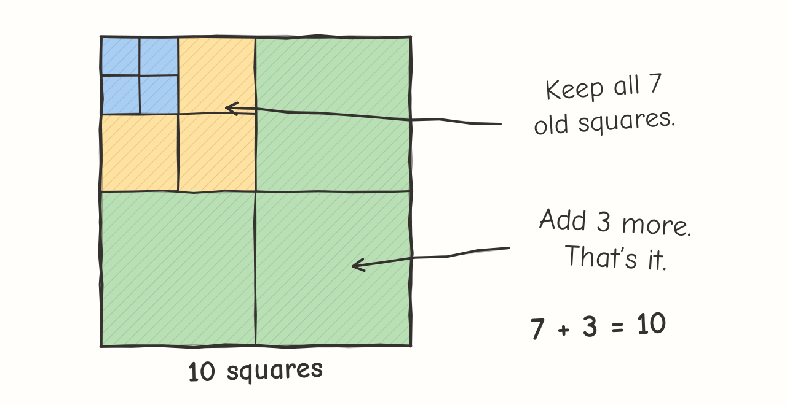

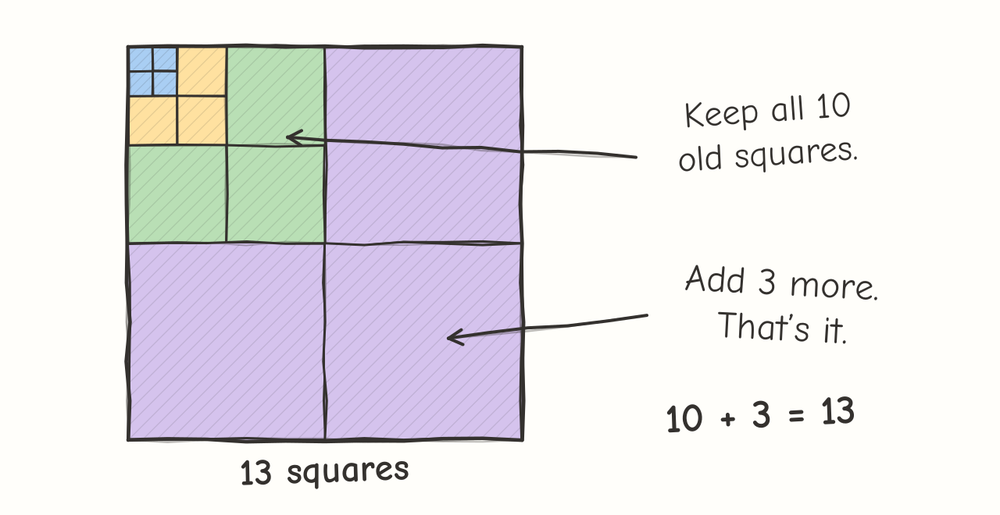

WOW.

I can keep going infinitely??? When I add 3 squares, I ended up with a $ \text{squarable} $. And because I have $ \text{squarables} $, I can make another $ \text{squarable} $.

Ok this is going great. We established that once we have a $ \text{squarable} $, we can continuously make new one by adding 3. But why 3? The equation says

$$
\text{squarable}_A = \text{squarable}_B + 2n + 1
$$

Well yes, when $ n = 1 $ then $ 2n + 1 = 3 $. But what is $ n $ value really? Can it accept any kind of value?

I remember we have the sum formula.

$$
n^2 = \sum_{i = 0}^{n-1} 2i + 1
$$

Ok so essentially, it says this right.

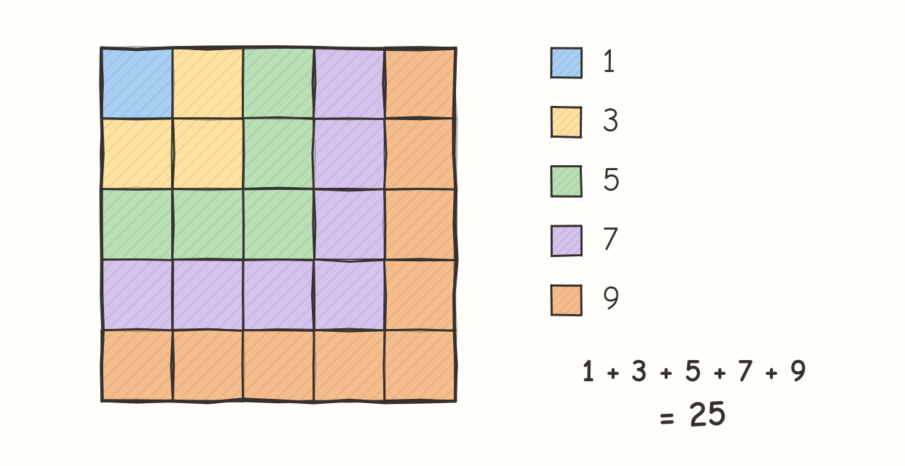

I see the pattern. We can get new square number by adding odd number. But since we don't need to have the square on the same size, we don't need to follow the strict $ +2 $ progression. We can use any odd number starting from 3.

$$
\text{squarable}_A = \text{squarable}_B + (2n + 1), n \geq 1
$$

Also yes, I cheated a little, I gave the conclusion before the observation. You don't have to read all of the journey to get there for that.

Ok now, we need an existing $ \text{squarable} $ to make whole of this works. What value could it be? I guess back to the most trivial solution: actual square numbers.

|n^2|+3|+5|+7|+9|+11|+13|
|-|-|-|-|-|-|-|
|1|4|6|8|10|12|14|
|4|7|9|11|13|15|17|
|9|12|14|16|18|20|22|

Wow, look over here.

```
1     4   6   8   10   12   14
      4     7   9   11   13    15
```

From 6 and onward, it zigzags. The gap from $ n = 1 $ is filled by value from $ n = 2 $ and vice versa. Therefore all value from 6 and onward, it is guaranteed some construction exist to build a bigger square.

Now what remains is for the value less than 6. Well the most trivial solution says the only square number (therefore how many square that can form bigger square) is only 1 and 4.

So our solution is really just

```ts
function isSquarable(n: number) : boolean {
    return n === 1 || n === 4 || n >= 6;
}
```


Or how I like it:
```ts
function isSquarable(n: number) : boolean {
    // The three first prime number!!
    return ![2, 3, 5].includes(n);
}
```

(PS. My real approach was mostly by algebraic route, which is not shown here. That route should show the proof of induction better, but that's boring. Prove by "see I told you look at the picture" is more fun.)

(PSS. In real proof, "the absence of proof is not a proof of its absence." This approach did not establish if 2, 3, and 5 is impossible as a squarable number. So this "proof" is incomplete. We should be able to see easily why 2, 3, and 5 is impossible though by some experimentation. I didn't write the impossibility of those values because this section is already too long.)

### Wow, I can't believe you made me read all that. What's the point of this

If you made it this far, great job and congratulations. But sorry not sorry.

I promised earlier that all of this exposition matters. It's time to fulfill that promise.

The whole previous section shows what it look like when you apply mathematical induction as a thinking process to solve a problem.

Consider the textbook definition.

1. Prove $ P(n_0) $ is true.

   I used the simplest solution for a squarable number: an actual square number. I used 1, 4, 9 as the first squarable number. By using these numbers, we "proved the base case held."

2. Prove $ P(x) \rightarrow P(x + 1) $ is true.

   The whole "if I have a $ \text{squarable} $, I can make a new bigger $ \text{squarable} $." walks through this process.

   Though if I'm allowed to be pedantic, the more accurate mathematical statement for this puzzle is actually:

   Prove $ P(x) \rightarrow P(x + 2k + 1), k \geq 1 $ is true.

Then in the end I showed that combining the (1) and (2), we have a nice one liner solution for the puzzle.

We just did the steps of proof by induction.

Isn't this great? We don't need to do rigorous proof to get the benefit of proof by induction. Well, as an engineer anyway. Who knows if some mathematicians out there cried when reading my "proof". What we software engineer can do is to adopt the thinking process embedded in proof by induction, and that might be enough for most of our day-to-days.

Now the big question: Must we learn the proof by induction? Like _must_ must? Is there any way we can do proof by induction easily as a software engineer?

Maybe not.

What I do know is how to **think using mathematical induction** accessibly as a software engineer.

## "Wake up Honey! It's time to make our dream into reality!"

This is how I abuse mathematical induction, and I found this method have high chance of success from personal experiences, alhamdulillah.

All I need to do is to follow this exact three steps.

### Dream

I have a problem. An engineering problem.

Wouldn't it be nice if it's solved already so I can go home?

What a dream.

Just imagine I have the solution right on my fingertips. How it get there or who gave it, I don't care. And I don't need to know. Maybe someone gave it to me. Maybe someone coded it for me. Maybe my favorite jippity spent 15 minutes to think for me. It doesn't matter.

All matters is that I have the solution right on my hand. Tangible and real.

**That I have some solution that directly usable to solve the problem.**

### Engineer that dream to reality

Company doesn't pay us to dream. They pay us to ship work. They want real tangible result, not fiction.

So roll up your sleeves, because this is where we are being paid for. Also maybe among the hardest part of the step, incidentally. You have been warned.

So the situation: the problem is still unsolved. But at least we have dreamed the solution. What we do now is:

**Capitalize, use, and abuse that dream to make an actual, real solution.**

_...Huh? How does that even work?_

Stay with me on this one. Try to answer this question:

> The original problem is solved. But the same problem reoccurred on top of the last solution. How do we solve the new problem?

_That is so **vague**._

I'll show you what it looks like a little later, insya Allah.

For now, just entertain me that **we managed to solve the new problem.**

### Find that dream

Okay it's time to wake up. Back to the living realm. Boss still don't see the result of our work. So we better get to it.

_"But we already engineered the solution!"_

Correction: We engineered the solution based on a dream. Unfortunately the company is here on earth, not on cloud nine.

So what we do next is "find that dream here on earth."

Just find that dream, even in the most mundane, most boring, most useless way possible.

**Prove that the dream exist here in this world.**

And that's it &mdash; these three steps is what I do to find my way to the solution: _dream, engineer that dream, find that dream._

Now it's time for the practical demonstration. The next section should showcase just how exactly we can apply these three steps, and how the benefit could show itself.

## The three steps, in action

### The square puzzle

Let's revisit the puzzle.

First, the dream: what do we want to have so we can solve the problem?

From my experience, it's normal to be unsure at this step. I do a lot of trial and error too at this phase. Simply because there's many possibilities i.e. we can dream many "solutions". But just pick one and see if it holds out.

#### Making the dream

For this demonstration, I will not (fully) redo the established steps from the previous section. So instead, the dream is: "I want to know all positive integer up to $ n $ is squarable." Therefore let's just think that we do have all numbers up to $ n $ that is squarable.

#### Engineering the dream

Now we move on to the engineering our dream to reality. The question we are supposed to answer is: "We already know all squarable numbers up to $ n $. But now I want to know all squarable numbers up to $ n + 1 $. How do we achieve it?"

This is where the hard work lies. And I'll be honest with you, even when I was writing this section, I still have difficulties. But here goes.

Remember that we _dreamed_ that we know all solutions up to $ n $. Can we use that solution/knowledge to solve for $ n + 1 $?

A squarable number can be obtained by adding some odd numbers starting from 3 into some other squarable number (we established this already from previous section). We can approach this in the opposite direction:

> Given $ n + 1 $, is any of the following number squarable?
>
> $$
> n - 2, n - 4, n - 6, ...
> $$
>
> If yes, then $ n + 1 $ is also squarable.

Since we _dreamed_ that all solutions up to $ n $ is on our hand, we can check all these values for any squarable.

That concludes the engineering phase.

#### Finding the dream

The principle for this phase is to find the smallest, even the most mundane, boring, "useless" dream in reality.

So let's start by having the smallest "dream": "I know all squarable numbers up to 1."

Ok, is 1 a squarable? Yes.

Next: is 2 a squarable? No. Try as we might, we can't get square made by 2 squares.

Next: is 3 a squarable? No. Ditto.

Next: is 4 a squarable? Now for a second, let's not use our existing knowledge that 4 is a square number. Instead, let's use our existing solution buildup:
1. 1 is squarable
2. 2 is not squarable
3. 3 is not squarable

We can find if 4 is square number by checking for $ 4 - 3  = 1 $. Is 1 a squarable? Yes. Therefore 4 is also squarable.

From 4 onward, we can reuse existing knowledge of which numbers are squarable and which are not. This is where we are stopping. The "finding the dream" phase ended when figuring out 3 is squarable or not.

(An avid reader may catch that "no, this is not where we are supposed to stop." If that's you, then congratulations for spotting it! Also please understand that we're halfway through the article and I still yet to deliver the core article idea. So I need to wrap this up hhhhh.)

#### Compiling the process

This is what this approach could look like as programming problem:

```ts
function isSquarable(n: number) : boolean {
  // I have a dream that I know all squarables up to x
  let isSquarable: boolean[] = [];

  // Find the smallest dream I need
  // 0, 1, 2, 3 = false, true, false, false
  isSquarable = [false, true, false, false]

  // Engineer that dream to reality
  for (let i = 4; i <= n; i++) {
    isSquarable.push(false);
    
    for (let j = 3; i - j > 0; j += 2) {
      // Use our dream (i - j) to make real solution (i)
      if (isSquarable[i - j]) {
        isSquarable[i] = true;
        break;
      }
    }
  }

  // The dream is real
  return isSquarable[n];
}
```

_What? Array and loop solution? Where's the one-liner solution?_

Hey, different dream yield different result haha. I don't promise the solution would be fast, just correct. And this is exactly the kind of "problem" you would face when adopting mathematical induction as thinking process:

**Different dream can yield into different solution.**

In the previous section where I walk you through the thinking process, my dream was "I can build a squarable." Here, the dream was "I know all squarable up to $ n $." And as you can see, the slight difference in the dream results in big change in the rest of the approach, and accordingly, to the result.

Sometimes the dream is real. Sometimes the dream is just a dream no matter how hard we engineer it to reality &mdash; there's just seem no way to get the solution from the dream. This is normal as far my experience goes. If this happens, we make a new dream. Iterate and revise.

And dreaming the right dream is _hard._ It's difficulty is comparable to trying to engineer the dream to reality. Being able to dream the right dream is its own skill, one which I still struggle pretty bad.

### Distributed system

Ho boy, you might want to sit down and grab a cup of tea. This section is going to be long. It will be about how the three steps could look like on the flesh. Hopefully these illustrations are faithful enough to give you an image how they look like when you apply them for real.

Okay, cool modern engineer nowadays no longer build CRUD application. Cool modern engineer now has shifted to make big scary system that can take on 10.000 RPS with 99.99% reliability. Monolith is so out of style. Microservice is the future.

_(That was a joke by the way please don't actually think microservice is good (as a default solution))_

So today, let's imagine we are being given a salami shopping system:

1. User can order salami
2. After ordering, user must pay for the salami
3. After successful payment, user will wait for salami to be delivered
4. User receive salami on their house
5. Happy customer

Not a complex stuff, just your usual shopping system.

Except the system's architecture has the application split to four separate deployments:
1. Inventory service &mdash; Handles what kind of salami we have and how many. Written in Java
2. Payment service &mdash; Does actual payment et al., naturally. Written in Go
3. Order service &mdash; Receives and manage customer order. Written in PHP
4. Shipping service &mdash; Sends salami. Written using Node.js

The mandate came: the architecture has lots of trouble &mdash; paid user did not receive salami on their house, user got double charged for a purchase, user bought salami when warehouse constantly out of stocked. We are assigned to fix them all. If something went wrong during the business process, it's our head on the table. Pay deduction, PIP, legal escalation, or straight up termination, you name it.

_Now, do your thing._ The boss says.

How can we make sure all of this work correctly? Or even better question: how can we **know** all of this **will** work correctly with high confidence?

We will walk through the problems the system suffered. Feel free to stop at each problem and try designing a solution yourself.

#### Problem 1: Salami is out of stock

User is paying for salami that we don't have. Now that is a huge disaster. I would establish safety for this first.

##### Making the dream

_The total number of salami user try to order is no bigger than the number of salami in stock._

This is the dream.

##### Engineering the dream

If the system already behaved that way, then a new customer try to order salami, how do we handle this new customer? Simply we do a check to inventory service:

- "For this salami, do we have enough to fulfill this order?"
    - No: stop the customer right there.
    - Yes: "add" the number of salami that user try to order.

This way, the number of salami that user tried to order would never go beyond the stock. This should be sufficient to prevent overselling.

##### Finding the dream

Then, what is the simplest form of that dream we can find? One of the possibility is: "Regardless of my salami stock, nobody has tried to order that salami."

This form works because of course, no one has ordered salami means the count is zero. And zero will never go beyond whatever our salami stock is. Therefore, this form fits our dream.

Experienced engineer may already spot the issue with this approach, and I concur. I will keep this approach regardless for storytelling purposes.

#### Problem 2: User for some reason being charged more than they should

Company checked: user sometimes got deducted **twice**. Users understandably are upset. After further investigation, for some reason some users called our payment service twice for the same order.

##### Making the dream

So what is the dream? It's surprisingly simple:

_I want the system to only process payment at most once for each order at all times._

##### Engineering the dream

If the system already behaved that way, then the customer try to pay for the order `ORDER-XYZ`, how do we handle this? There are two situations:

1. The customer hasn't paid for the order `ORDER-XYZ`. In this case, let the request go through as usual.
2. The customer has paid for the order `ORDER-XYZ`. In this case, prevent the request going through.

So we check if customer have paid for the order first before processing them. This should be sufficient to prevent the double charge.

##### Finding the dream

Now, we find the dream: what is the simplest form we can find in reality? One of the answer: "Customer has not paid for the order at all."

This form fits because "has not paid for the order" means "zero payment attempt". And zero payment attempt fits the "order payment being processed at most once." That's sufficient for the dream.

This design establishes that at any point of time, if a customer has paid for some order, and then try to pay for the same order, we will prevent that request from being processed. Therefore this solution is successfully designed to make it impossible to double charge users.

#### Problem 3: Shipping department didn't know that the customer has paid successfully and they must deliver the salami

The "Infra Guy" found out that **the shipping service crashed for 5 minutes.** Incidentally, customers who complained they never receive the salami also finished their payment during that crash window. Putting 2-2 together: a customer finished payment, but the shipping service did not (and cannot) receive the request from payment service to prepare the order for delivery. Simply because it crashed. So what to do to prevent this ever from happening again?

##### Making the dream

My dream is:

_Successful payment **must** mean shipping service gets notified for the delivery immediately._

##### Engineer the dream

Now we engineer that dream. Suppose the shipping service knows all the delivery it needs doing, then a customer successfully finished the payment. How to handle this situation?

Naturally, the payment service should immediately call the shipping service's API. But as established in the problem, the shipping service can go down, then suddenly we cannot let it know.

One other way is to _wait_ until the service go up again, but that is risky: how long does payment service needs to wait? Payment service still need to process other incoming request. Waiting for shipping service to go live again can block other requests. So this solution is no go.

##### A false dream

This dream is so hard. It feels impossible to make this dream to reality. But what if we don't have to wait? What if I dreamed the wrong dream? What if...

_Successful payment **must** mean shipping service gets notified for the delivery **sooner or later**._

...I don't have to send it immediately? As long as the shipping service got it in the end in quick enough time, the shipping department can work no problem.

There are some competing problems though:
1. Payment service has handlers that accept the finished payment information.

   This handler must be quickly available to accept the next payment information.
2. This handler should not call the shipping service directly in case the service went under.
3. The delivery information must reach the shipping service.

##### A wishful thinking

Ok we're going in circles, how exactly do we approach this? It looks so impossible.

_I wished I have something that takes the information from the handlers and can send them to the shipping service in hope it's already live again._

Hold on. We can capitalize this _wish_.

Assume that we have the "something":
1. it is capable to collect the information from the handlers,
2. and capable to hit the shipping service's API.

Then what can we do next to handle a new finished payment information?

1. Accept the information from the handler (utilize capability (1)). The handler is now free to be reused.
2. Notify shipping service using the stored information (utilize capability (2)).
3. If the shipping service accepts them, we're done
4. If the shipping service did not seemingly accepted them, try again some time later.
5. When new information arrive, pick it up and wait to send all of the information together (utilize capability (1)).

Alright. Now we're getting somewhere. Let's try to find that dream. What's the simplest form of the dream?

Maybe it's: **the "something" has nothing to send to the shipping service.** When there's nothing to send, we don't need to notify the shipping service. Technically this form fits the dream.

Let's name this "something." How about "Outbox"? It's like inbox, but instead of receiving message, we deliver messages but we save the message somewhere first so it doesn't disappear if the recipient cannot receive them.

_...What? Someone already used that name?_

---

Wow that was messy. But that's just how it has always been, and I suspect once you adopt this mental model, you would encounter this messiness too.

Also here's a bonus for homework:

What would have happened when I wished that _"I have something that takes over information from the handlers, and **the shipping service can receive that once it goes live.**"_ instead of _"something that sends to shipping service in hope it already went live."_?

---

Great, we have made solutions that addressed the problems. We should be able to kick back and relax a little. Great job team!

...Unfortunately for us, life is full of surprises.

#### Problem 4: Two users ordered the same, last salami

What? How's that possible? _We literally just designed a flow that prevent making order beyond our stock count!_

The "Infra Guy" came by: "These two orders were made in a nearly same time."

vcvnzcvzxkcjvnadsf

So our previous process made an implicit assumption: orders are made sequentially. Now, this by itself is not wrong. Our approach on problem 1 holds. It's just that assumption did not hold up to the real situation. Once the assumption is violated, as we have seen, the whole thing breaks.

Put simply: We used mathematical induction to come up with correct solution **under specific assumptions**. Mathematical induction does not automatically give us a solution that works for every situation.

So here's the updated situation. The code says the following process:
1. Endpoint handler receive incoming request
2. Handler checks for the stock in the database
3. If the stock is enough, process the request, adding the amount into the "ordered count" into the database
4. If the stock is not enough, stop and fail the request
5. // ...Further processing...

And this is what actually happened:

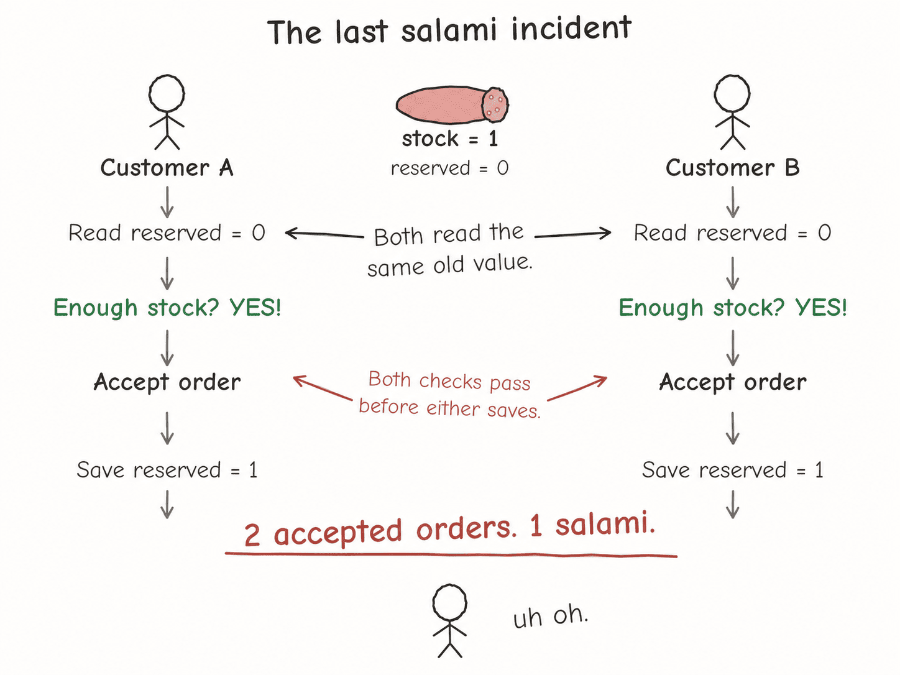

##### Making the dream

So what do we do? We make a better dream. This is mine:

_I want that there is only at most one request that can perform the whole order creation process (step 2-4) at all times._

##### Engineer the dream

Then we engineer the solution. Let's say there really is just one request going on at this moment. Then suddenly a new request came in. What do we do?

Well naturally we prevent them from starting step 2 until the current request is done. I don't know. Maybe I can make something that marks if some request is ongoing. Once the request is done, unmark that value. The next request should be able to "use up the slot." Then the whole process repeats.

##### Find the dream

Ok, now just to find that dream. What is the simplest form of that dream? The answer: "When there is no process running right now." In this form, the value is "unmarked", so any incoming process can immediately "use the slot". This form satisfies "at most one process being executed at this moment."

So something that conceptually look like this.

```java
public class Processor {
    // Find that dream
    // The value is "unmarked"
    private AtomicBoolean isOccupied = new AtomicBoolean(false);

    public void execute(Handler handler) {
        // Engineer that dream to reality
        // "Mark" the value
        while (!isOccupied.compareAndSet(false, true)) {
            Thread.onSpinWait();
        }

        try {
            Salami salami = InventoryRepository.getById(handler.salamiId);

            if ( salami.currentCountForOrder + handler.salamiCount <= salami.stockCount ) {
                salami.currentCountForOrder += handler.salamiCount;

                InventoryRepository.save(salami);
            }
            else {
                return;
            }
        } finally {
            // Unmark that again
            isOccupied.set(false);
        }

        // ...Further processing...
    }
}
```

With this, we have designed a solution for the problem. Magnificent right? We used the thinking in mathematical induction to solve a "low-level" problem. We made a gatestopper to control who can go in and out.

So that any processes can exclusively hold that important flow for themselves. Mutually exclusive, you could even say.

Now if you think something along this line:

_"That is such a weird way to solve this kind of problem."_

I feel you, and I agree. I got some words about that on the closing section.

#### Section closing

And that's it &mdash; a mathematical induction applied to engineering work in the flesh! The examples shows the process to arrive to the solution without us jumping ship blindly.

I would like to stress though, many solutions presented here are directionally correct but the quality for the production system is subpar. So please reconsider if you're adopting these into your own system.

Fun side note: these solutions are several steps away into production-grade. They really just need to go into several iterations of dreaming again before they turn into something a professional would use. I deliberately don't get into that direction because this section is already long.

## How to practice

Now you have seen how thinking in mathematical induction can be applied and how it unlock so many things. Then, how can we get to practice it?

You are reading my article, so I'll give you my own recommendation: programming problem LeetCode style

Yes, I'm being serious. Programming problem is great simply because it doesn't need so many setup (tooling etc.), no need too much specific domain knowledge (e.g. microservice, database, concurrency etc). It's just a problem, and your IDE, and the judger. Programming problem is the most ergonomic way to practice thinking in mathematical induction.

But not all programming problem is suitable to practice. I highly suggest:
1. Dynamic programming problem. Solve it in bottom up. In my experience bottom up solution **always** approachable by proof by induction, so try to come up with bottom up solution. Try medium difficulty. Hard difficulty only as a challenge, but IMO hard difficulty has diminishing return compared to medium difficulty. And most importantly try to do the three steps above.
2. Linked list problem. No I'm not joking hahaha. Linked list problem is surprisingly a good problem for practicing thinking in mathematical induction, but only when doing it in a specific way: solve it so that your solution run in linear time. This should force you to ask the right question (i.e. "to dream correctly.")
3. Any problem that should be solved using loop that's not in form of `for (int i = 0; i < n; i++)`. This is slightly trickier to find because you need to know beforehand how to solve the problem. Two pointer problem is a good example of this problem family.
4. Niche data structure problem. Maybe segment tree, maybe trie, etc. Very good problem. These problem could shape mental model that can carry over to real world application where "people store data" and "people pull data" is a very common pattern.
5. Query problem, for the same reason as above. This problem family's defining characteristic is its input format involves "save" values, "get" values, and even "delete" values.

Ultimately, pick problem that you're unfamiliar with but still comfortably within your capacity. The goal is to expose yourself as much as possible to unfamiliar problem so you're not relying on memory to solve them.

For the extra challenge, aim for 1 wrong answer, no more. This should force you to think through your solution and ensure it's correct before submitting. Apply thinking in mathematical induction in the correctness check. Don't primarily rely on making testcase to check for correctness. Use testcases to complement thinking in mathematical induction &mdash; to catch if our line of thinking holds up.

## That's a wrap!

Whew, that's a lot of text.

There's still a lot to cover: the elegance of mathematical induction, its ergonomicness for solving problem which leads to some watchouts on how to pick which dream that might work, the list goes on. But this article is supposed to be an introduction into mathematical induction and I already take up pretty big spaces for that, so those will have to wait.

I should write something memorable here, but there really is just so many things to say before this whole article become "Mmhm yeah I like your big words."

So I'll condense it to this:

How you dream shapes how you could prove.\
How you prove shapes how you could engineer.\
How you engineer shapes how you could code.

So dream lots, dream right, and prove that dream. Hopefully once done often enough, that will make you a more adaptable, more resilient software engineer.

And If you want a correct code, make a correct proof. Because often, how you prove is how you code.

Now excuse me I want to lay down hhhhh.